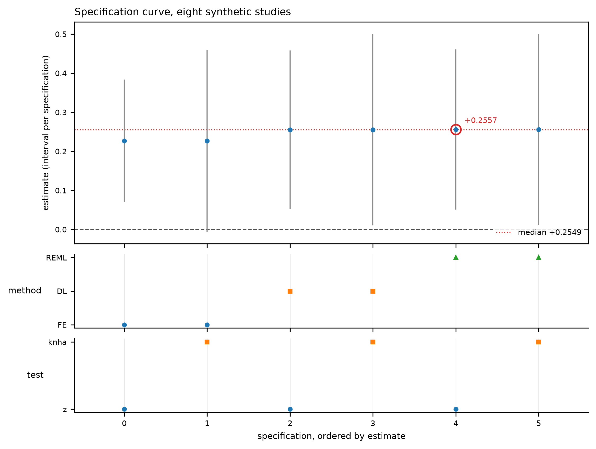

# Multiverse analysis

A multiverse runs every analysis that was defensible *before* the results were
seen and asks how far the answer moves across them. It is not a search for the
result you like, and it is not model averaging: averaging over a multiverse would
be averaging over analyses whose weights nobody defined.

Prerequisites: the decisions have to be declared first — see
[Reproducible analyses](reproducibility.md#declaring-the-decisions-analysisspec).

```python
import pimeta as ma

spec = ma.AnalysisSpec(decisions=(
    ma.Decision(name="method", values=("REML", "DL", "FE"), default="REML",
                reasons={"REML": "the default here; less biased at small k",
                         "DL": "what most published analyses used",
                         "FE": "the assumption of no heterogeneity"}),
    ma.Decision(name="test", values=("z", "knha"), default="z",
                reasons={"z": "the nominal reference",
                         "knha": "wider when the studies disagree"}),
))

def run(choices):
    return ma.rma(yi, vi=vi, method=choices["method"], test=choices["test"])

mv = ma.multiverse(spec, run)
print(mv)
```

```text
Multiverse over 6 specification(s): 6 usable, 0 failed
  estimate range -0.0412 to +0.0518 (median +0.0104)
  sign agreement 0.67; 2 of 6 intervals exclude zero
  test: 0.71 of the spread
  method: 0.29 of the spread
```

`mv.diagnostics` is the grid-level counterpart of a fit's diagnostics, with the
same `codes()` / `worst` interface:

| code | severity | fires when |
|---|---|---|
| `no_usable_specification` | error | nothing usable — there is no curve to read |
| `specification_failed` | warning | some specifications produced no estimate at all |
| `specification_excluded` | warning | some were dropped because their own fit reported an error |

An empty curve with no diagnostic would read as "no spread", which is the
opposite of the truth, so that case is an `error` rather than a quiet `0`.

## The five quantities, and what each one is not

| Quantity | Reading |
|---|---|
| counts: considered, run, usable, failed, flagged | the only numbers that are not a statistic |
| sign agreement | how often the analyses agree on the direction |
| intervals excluding zero | an **unweighted frequency over analyses** |
| estimate range and quantiles | how far the answer travels |
| variance by decision axis | where the spread sits, descriptively |

**The share of intervals that excludes zero is not a probability that the effect
is real.** `M` analyses are not `M` independent experiments: they share the same
studies, so they are not independent, and the grid is not a prior over
hypotheses. A multiverse where 80% of specifications are significant is not
evidence that is 80% likely to be true; it is evidence that survived four of five
sets of choices.

**The variance decomposition is descriptive.** It is a one-way decomposition, so
an interaction between two decisions is left unattributed and the shares sum to
less than one. An unbalanced grid moves the numbers too, and a decision can look
important simply because its levels happen to be paired with another decision's
favourable level. Read it as "where does the spread sit", never as "what caused
it".

## Failures are counted, not dropped

```python
mv.counts()        # {'considered': 6, 'run': 6, 'usable': 5, 'failed': 1, 'flagged': 0}
mv.failed          # [{'id': 'sha256:...', 'choices': {...}, 'error': '...'}]
```

A specification that did not converge, or whose result could not be reduced to an
estimate, stays in the output with its id, its choices and its error. Dropping
those rows is the largest silent bias in a published multiverse: the analyses
that break are not a random subset of the analyses that work, and a table that
lists only the survivors reports a stability it never measured.

The same applies to a result whose estimate is not finite — it is a failure with
the reason attached, not a `NaN` quietly entering an average.

### A number a fit disowns is not a usable number

An error is not the only way a specification can go wrong. A fit can return a
finite estimate and still say, through its own diagnostics, that the number
should not be reported — `not_converged`, an ill-conditioned design, a variance
component pinned at zero. Those specifications are listed in `mv.flagged` with
the codes they raised, and by default they are **left out of the curve**:

```python
mv.counts()   # {'considered': 6, 'run': 6, 'usable': 4, 'failed': 1, 'flagged': 1}
mv.flagged    # [{'id': ..., 'codes': ['not_converged'], 'worst': 'error', 'excluded': True}]
```

`require_clean=False` keeps them in the curve and only records them. Either way
they are named, because a flagged specification that disappears from `usable`
without appearing anywhere else is the same silent filter this section is about.
A warning-severity diagnostic such as `few_studies` is recorded but does not
exclude: only a fit that calls its own output an error is removed.

A specification that is flagged **and** excluded is in neither `usable` nor
`failed`. The two lists never both name the same specification, so
`run == usable + failed + excluded`, where `excluded` counts the flagged entries
whose `excluded` is `True`.

## Reading the curve

```python
for row in mv.curve():          # ordered by estimate
    print(f"{row['estimate']:+.4f}  {row['ci_lb']:+.4f} {row['ci_ub']:+.4f}"
          f"  method={row['method']} test={row['test']}")
```

Ordered by estimate rather than by grid position, because the question is where
the answer sits, not in what order the loop visited the cells. Each row keeps the
choices that produced it, so a cluster of similar estimates can be traced to the
decision that defines it.

### The figure

```python
fig = ma.plot_specification_curve(
    mv, mark_default=mv.curve()[0]["id"], filename="curve.png")
```

The upper panel is the curve: one interval per usable specification, ordered by
its estimate, with the median marked. The panels below are the decision margins —
for each decision, which value each specification took. Reading down a column
says "these analyses agreed on this decision"; reading across a row says "this
decision changed here".



The picture above is the committed render of
`python tools/make_figures.py`, on fixed synthetic data rather than a real
meta-analysis. It is regenerated by that script and checked into the repository,
because a plotting function can pass every assertion about its return value and
still draw one visible dot: this figure did exactly that once, when its x axis
was in effect sizes and its margins were at ordinal positions.

The margins are the point of the figure. The curve alone invites the reader to
attribute the movement to whichever decision they already suspected; the values
underneath make a *cluster* visible instead, and a cluster is what an interaction
looks like. The decomposition's blind spot and the figure's useful feature are
the same thing seen from two sides.

`mark_default` puts the primary analysis inside its own multiverse. A figure of
this kind should always be able to say which of the specifications it draws was
the one pre-specified.

## Choosing an estimand

`multiverse` needs `(estimate, ci_lb, ci_ub)` per result. The default reads the
first coefficient, which is the pooled effect for an intercept-only model and the
intercept for a meta-regression — rarely what you want there. Pass `extract=`:

```python
def slope(result):
    return result.b[1], result.ci_lb[1], result.ci_ub[1]

mv = ma.multiverse(spec, run, extract=slope)
```

## The report

`ma.specification_report` renders the whole grid as one table: every
specification, in grid order, with its status beside its number.

```python
report = ma.specification_report(mv, title="Pooled effect",
                                 provenance="BCG trials, run 2026-10-26")
print(report.markdown)      # or report.save("specifications.md")
```

Rows in grid order rather than ordered by estimate, because the table audits the
grid: sorting by the answer would re-introduce the selection the module exists to
expose. A specification that failed keeps its row and shows the exception; one
that was excluded for an error-severity diagnostic shows its codes and **not** its
number, so a reader cannot quote a figure the fit disowned. The three caveats from
the top of this page travel with the table, because they are the part that gets
lost when a table is pasted somewhere else.

On a dataset where the between-study variance is estimated at zero, the table is
worth reading literally: every specification then gives the same estimate, and the
absence of movement is a fact about the data rather than a demonstration of
robustness. Each row carries `tau2_zero` for exactly that reason.

## See also

- [Sensitivity analyses](sensitivity.md) — one assumption at a time, no grid
- [Reproducible analyses](reproducibility.md) — declaring the decisions and recording the runs
- [Roadmap](roadmap.md) — what this deliberately does not do
